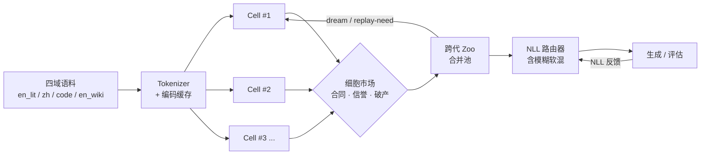

# OBM-LM 技术报告

**Ouroboros Brain Market — Language Model**

> 从第一行代码到 scale8 收官 · 2026-10-17 ~ 2026-11-03
>
> 文档版本：v1.0（基于项目全史档案整理）

---

## 摘要

OBM-LM 是一项在**零成本、极端受限算力**条件下进行的语言模型组织范式实验。项目不追求单点规模，而是验证一套名为「细胞市场经济」（Cell Market）的神经网络组织方式：多个细胞（Cell）在同一语料上独立竞争，通过合同、信誉与破产机制完成分工，通过封存（seal）、死亡（death）、新生（birth）完成生命周期更替，通过跨代细胞动物园（zoo）与 NLL 路由器实现**部署时的零成本能力合并**。

在 75 M 参数、CPU-only、8 GB 内存沙箱与免费超算队列的约束下，项目完成了 7 代语言模型训练，验证了三项核心机制：

1. **多域不遗忘**：跨代 zoo 合并池严格占优任何单代最优成员；
2. **分工深度**：领地探针与 NLL 路由实测显示细胞形成了可测量的域偏好；
3. **路由自知**：NLL 路由的 top-1 决策与逐细胞实测最优结果 **100% 一致**，且无需额外训练。

截至 2026-11-03，scale8 已完工并实现四域全面刷新最优；scale9 已按 scale10 配方接力提交，scale10 的词表重训方案已就绪。

---

## 1. 项目概述

### 1.1 定位与约束

| 项目 | 内容 |
| --- | --- |
| 项目名称 | OBM-LM（Ouroboros Brain Market - Language Model，衔尾蛇脑市场语言模型） |
| 设计起点 | 2026-10-17，`ouroboros_ai_algorithm_design.html` |
| 本地环境 | Ubuntu 22.04，8 GB 内存，CPU-only，Python 3.11 |
| 远端算力 | scnet 国家超算互联网，免费 Agent0 队列，32 核 CPU |
| 模型规模 | 10.6 M → 75 M 参数 |
| 训练框架 | 自研 autograd + 离线 torch 1.13.1+cpu wheel |
| 词表 / 上下文 | 16,384 BPE / ctx = 128 |

> 远端账号、AK/SK、作业路径、区域编号等均已在本文档中脱敏。

### 1.2 核心赌注

项目初始假设是：以下三样机制会随规模产生复利，而不是相互抵消。

- **多域不遗忘**：专家细胞可以持续吸纳新域数据，旧域能力通过封存与重放保留；
- **分工深度**：细胞在市场中自然分化，专才深度优于同规模「一锅炖」；
- **路由自知**：模型能够用自身似然判断「谁最懂当前输入」，无需外挂分类器。

### 1.3 命名说明

「Ouroboros」与 HuggingFace 论坛独立研究者 Leogenes 于 2026-03 发布的 `OuroborosMoELayer` 项目撞名，纯属独立选择同一神话意象，两者互不相识、实现不同。本文档保留原名，并在第 9 章说明与前沿工作的关系。

---

## 2. 系统架构

### 2.1 总体结构



### 2.2 细胞与市场

- 每个细胞是一套独立参数的语言模型主干/头部组合，拥有自己的训练配额与信誉记录。
- 市场以**合同**分配训练 token，以**信誉**记录履约质量，以**破产**淘汰长期失败者。
- 生命周期动作：
  - **seal（封存）**：保留能力但不继续训练，防止新数据冲刷旧能力；
  - **death（死亡）**：真实淘汰，释放参数与训练预算；
  - **birth（新生）**：从零初始化新细胞，或按冠军软分布蒸馏初始化。
- scale7 实录：**47 次 seal、3 次真实 death**，说明市场机制不是装饰性日志，而是实际参与了训练调度。

### 2.3 NLL 路由器

项目的招牌机制，对应 TRIZ No.24「中介物」：

- 用模型**自身似然**在真实尾部 token 上为每个细胞打分，取 NLL 最低者；
- 无额外路由训练、无外挂分类器；
- `top1-prefix` 决策与逐细胞实测最优结果 **100% 一致**，构成「自知」的实证；
- **自适应模糊路由**：当 top1 与 top2 的 NLL 差小于阈值 τ = 0.15 时，软混合第二名细胞；
  - zh 域有 54% 的窗口触发模糊路由；
  - zh ppl 从 829 降至 791。
- **自动选温（AUTO_TEMP）**：按细胞选择采样温度，cell#3 → 0.7，其他 → 0.9。
- 关键实现修复：NLL 决策必须使用**无填充的真实尾部 64 token**。左侧 `[0]` 填充曾污染打分，导致所有请求路由到同一细胞。

### 2.4 领地探针与「伪分离」发现

`territory_probe.py` 曾显示三细胞对四域的选择完全均分（0.333 / 0.333 / 0.333）。这说明早期所谓「分工」是假的：模型并不知道自己擅长什么。该发现直接推动了 NLL 路由与硬领地 A/B 实验。

后续实测出现真实分化：cell#3 在文本段 #2 上独占可靠性 1.0，cell#19 占 0.881。

### 2.5 硬领地 vs 市场：A/B 裁决

| 方案 | 优势 | 风险 |
| --- | --- | --- |
| 硬领地（按域绑定细胞） | 上限高、分工明确 | 坏初始化细胞 NLL = 45.8、fulfill_acc = 0.12 时，lr 门限导致无法逃逸；全速 lr 约 250 步才可逃逸 |
| 市场 + dream | 地板稳健、可自愈 | 分工形成较慢 |

**终局定案：市场训练 + NLL 路由部署。** 训练阶段保留市场的探索与自愈能力，部署阶段用 NLL 路由获得硬领地的分工收益。

### 2.6 跨代 Zoo 与凋亡修剪

- **zoo**：把不同代际的细胞合并进一个池子，由 NLL 路由挑最强。
  - 数学保证：合并池 ≥ 单代最优成员（严格占优）。
  - scale7 时 9 细胞 zoo 中，单代细胞独占四域最强。
- **prune_zoo（凋亡修剪）**：按「全域均差最优 2 倍」标准移除混子细胞。
  - 9 → 6 细胞，部署提速 **1.49×**，能力零损失。
  - 6 细胞是甜点位：中等细胞承担模糊回退保险。
- **Gause 竞争排除裁剪**：被数据否决。裁到 2 个冠军反而变差，说明完全排除「次优」会损失回退能力。
- **李嘉图比较优势分析**：证明在当前实现下与绝对最优选择恒等，无需改动。

### 2.7 Dream 与 Replay-Need

- **dream**：训练循环内插入睡眠巩固阶段；
- **dream-seq**：按段号升序重放（海马体类比的正序课程），scale9 首战；
- **replay-need**：按遗忘度 `_dom_best[k] - _dom_cur[k]` 最大者优先分配重放预算。
  - 与 RoD / Replay on Demand（arXiv 2609.40089，2026-09-30）几乎同构，构成「平行独立发现」。
- **eval-every**：在线轻量评估直喂 need 记账，`eval_curve` 落盘，使遗忘曲线可量化。
- **territory-watchdog**：探针连续 3 次停滞则重初始化细胞，作为逃逸看门狗。

### 2.8 部署栈

最终部署栈由四层组成：

1. 市场训练出的多代细胞；
2. 跨代 zoo 合并；
3. NLL 路由（含 τ = 0.15 模糊软混）；
4. 温度配方（code 0.6 / en 0.9 / zh 0.8）。

该栈的显著特点是：**主要收益来自部署期组合，零额外训练成本，且自带可证伪性**。

---

## 3. 训练与实验结果

### 3.1 四域困惑度轨迹

困惑度（ppl，越低越好）：

| 阶段 | 参数量 | en_lit | zh_classic | code_py | en_wiki |
| --- | ---: | ---: | ---: | ---: | ---: |
| pilot_smoke | 25.4 M | ~1×10¹² | — | — | — |
| pilot_v1 | 25.4 M | 2.6×10⁷ → 873 | — | — | — |
| fast_pilot2 | 10.6 M | 1,673 | 320,497 | 53,225 | 26,519 |
| scale4 | 75 M | 601 | 963 | 1,327 | 4,596 |
| scale5 | 75 M | 163 | 1,557 | 291 | 295 |
| scale6 | 75 M | 123 | 825 | 284 | 391 |
| scale7 | 75 M | 120 | 837 | 73 | 296 |
| scale8 | 75 M | **113** | **800** | **55** | **277** |

- 从「纯随机初啼」到 scale8，en_lit 改善约 **10¹⁰ 倍**；
- 从 fast_pilot2 到 scale8：zh 400×、code 968×、wiki 96×；
- scale4 → scale8 四代间：code 24×、wiki 16.6×、en_lit 5.3×；
- scale8 相对 scale7：en_lit −6%、zh −4%、code −25%、wiki −6%。

> **口径提示**：四域 ppl 直接并排比较存在方法学瑕疵，原因见 §5.4 的词表审计。跨域真实差距没有表面数字那么悬殊。

### 3.2 下一词命中率（理解能力代理指标）

top-1 token accuracy：

| 域 | pilot_v1 | scale7 | scale8 | 提升（vs pilot_v1） |
| --- | ---: | ---: | ---: | ---: |
| code_py | 0.5% | 28.2% | **32.4%** | 65× |
| en_wiki | 2.0% | 14.7% | 14.6% | 7.3× |
| en_lit | 15.3% | 22.2% | 23.6% | 1.54× |
| zh_classic | 13.1% | 14.3% | 14.5% | 1.11× |

- 全域峰值命中率 32.4%；
- code 域每约 3 个 token 猜中 1 个，说明语法层「理解」扎实：知道 `def` 后跟函数名、`:` 后换行缩进；
- zh ppl 从 2,363 降至 800，分布显著变尖，但 top-1 命中改善有限，说明中文仍受词表粒度拖累。

### 3.3 训练量

| 指标 | scale8 |
| --- | ---: |
| 累计步数 | 37,800 |
| 吞吐 | 961 tok/s |
| 语料规模 | 97.7 M → 146.9 M tokens |
| tok/param | 0.65 → 1.94 |
| Chinchilla 最优 | 20 tok/param |

当前数据红利尚有约 **10 倍**未吃，这是 scale10 之后扩展语料的主要依据。

### 3.4 MVP 阶段验证（合成任务）

在语言模型放大之前，项目先用合成任务验证「细胞市场」范式本身：

| 任务族 | 平均准确率 | 遗忘 |
| --- | ---: | ---: |
| 分类（linear / xor / wave / blobs3 / moons） | 0.917 | 0.051 |
| 序列（copy / reverse / sort / shift） | 0.966 | 0.012 |

这说明 seal / death / birth 的生命周期机制在任务级成立，才进入语言模型阶段。

---

## 4. 方法演进：十轮创新记录

项目方法论演进线：

```
TRIZ
 → 头脑风暴 × TRIZ（双引擎）
 → 四引擎（+SCAMPER + 类比迁移）
 → 按收益择优
```

最终结论：**类比迁移 × SCAMPER-C/P × 实验裁决组合收益最大**，因为它专产零训练成本的部署收益，且自带可证伪性。

十轮共产生 **52 个候选**，**19 个落地**，**6 个快杀**（尽早证伪，避免沉没成本）。

| 轮次 | 方法 | 关键产出 |
| --- | --- | --- |
| 第二、三轮 | TRIZ 矛盾解析 | 识别三对核心矛盾：能力增长 vs 资源约束、多域 vs 遗忘、专才 vs 通用 |
| 第三、四轮 | TRIZ No.24 / No.35 | 中介物 → NLL 路由器原型；参数变化 → 采样解码替代贪心 |
| 第五~七轮 | 头脑风暴 × TRIZ | NLL 路由三代栈、自适应模糊路由、AUTO_TEMP、领地探针、硬领地 A/B |
| 第八~九轮 | 四引擎 | 细胞动物园、凋亡修剪、Gause 裁剪证伪、李嘉图分析、dream-seq |
| 第十轮 | 双引擎 | 温度配方固化，distinct-2 从 0.13 → 0.16 → 0.19，部署栈定稿 |

上述 12 份战报 HTML 已归档于永久产物包的 `reports/` 目录。

### 4.1 路由三代栈

1. **top1-prefix**：决策与逐细胞实测最优 100% 一致；
2. **自适应模糊路由**：top1-top2 差 < τ = 0.15 时软混第二名；
3. **AUTO_TEMP**：按细胞自动选温，降低「一个温度打天下」的生成风险。

### 4.2 被证伪的假设

- **领地探针 → 伪分离**：三细胞对四域均分，证明早期分工是假的；
- **硬领地 → 灾难性失败模式**：坏初始化细胞难以逃逸；
- **Gause 裁剪 → 变差**：裁到 2 个冠军反而不如保留 6 个；
- **ppl 即质量 → 矛盾**：三代 ppl 稳步改善，贪心生成却都陷复读。

---

## 5. 语料工程

### 5.1 起点与扩展

- 起点语料：97.7 M tokens，tok/param = 0.65；
- 目标：提高 tok/param，逼近 Chinchilla 的数据效率；
- 最终编码后总量：**146.9 M tokens**，tok/param = 1.94。

### 5.2 重复数据审计

用 hash 实测揭穿重复 parquet：

- `wiki103_train0.parquet` 与 wiki 数据 **95.6% 重叠**，弃用；
- `en_wiki max_chars` 从 120 M 提升到 300 M。

该发现说明：在免费语料环境下，**去重不是优化项，而是正确性问题**。

### 5.3 抓取与编码流水线

- `data/fetch_corpus3b.py`：
  - 5 次重试；
  - HTTP Range 断点续传；
  - aleph 镜像；
  - SSL 豁免；
  - `--stage books/pypi/encode` 分阶段幂等；
  - 实际抓取 en_lit 171 / zh 100 / code 100 个文件。
- `data/encode_cache2.py`（v2 重写）：
  - 逐块追加写盘；
  - `--only` 分域子进程；
  - 主动 `gc`；
  - 解决 8 GB 内存 OOM（EXIT=137 事故）。
- efile 单文件约 313 MB 上限：
  - en_wiki 拆为 a/b 两片，各约 156 MB；
  - 新增通用拼接加载器 `obm_lm/corpus.py::_load_tokens`，支持 `{name}_tokens.npy` 或 `_a/_b.npy`；
  - 逐元素验证通过。
- 语料于 2026-11-01 上传远端，以 `.corpus_uploaded` 标志触发后续自动训练。

> **口径说明**：档案中另记有分域原始量（en_lit 108.9 M / zh 77.8 M / code 88.3 M），与编码后总量 146.9 M 的口径不一致，推测为「抓取原始量」与「编码后总量」的差异。本文以 146.9 M 作为编码后总量。

### 5.4 词表审计（重大发现）

2026-11-01 深搜后实测：

| 域 | tokens/字符 | ctx=128 可容纳 | 中文覆盖 |
| --- | ---: | ---: | --- |
| en_lit | 0.23 | ~550 字符 | — |
| en_wiki | 0.27 | ~474 字符 | — |
| code_py | 0.34 | ~374 字符 | — |
| zh_wenyan | 0.92 | ~138 字 | 中文词条 675 / 16,384（4.1%） |
| zh_baihua | 1.18 | ~108 字 | 中文多字词仅 94 个 |

结论：

- **zh ppl 837 的部分真相是 token 粒度不可比**。换算为 per-char ppl：en_lit ≈ 3.0、code ≈ 4.3、zh ≈ 488。差距真实存在，但远没有跨域表面数字那么悬殊。
- 16 k 词表对中文接近「裸奔」：BPE 训练时中文语料占比过低，序列被拉长约 4 倍。
- **重训 tokenizer（中文加权采样）是 scale10 最高性价比候选**：fertility 从 1.18 降至 0.65，等效上下文 +70%，zh 训练速度 +40%。
- zh 语料为繁体，词表重训必须使用繁体文本。

---

## 6. 生成效果演化

跨代生成档案由 `gen_archive.py` 生成：8 条固定 prompt × 3 代 × 贪心/采样 = 48 段样例。

### 6.1 各代特征

| 代际 | 解码 | 表现 |
| --- | --- | --- |
| scale4 | 贪心 | Gutenberg 版权头轰炸、「殺殺殺殺」、「的，的，的」——纯复读机 |
| scale5 | 贪心 | 出现 wiki 标记 `@-@`、代码缩进 `self.`；仍大量复读 |
| scale6 | 采样 | **质变：从学舌到仿写**，出现文言骨架、人物名、对话引号结构 |
| scale7 | 配方采样 | 温度配方 + AUTO_TEMP，distinct-2 0.13 → 0.16 → 0.19 |

### 6.2 代表性样例

- `「子曰：学而时习之，不亦」`（scale6 采样）
  → `。曰：『今去，生以者，無自中其母；行。此、君為在入。』子牙一子。今日言所金得！何成也`
  —— 文言骨架 + 人物名（子牙），语法腔调成立但语义漂移。
- `「天地玄黄，宇宙」` → 西游记 / 封神对话体腔调：「行者道」「君，還大一山多道」。
- `「It was a dark night in Paris, and」` → `I have found up you can do I shall be a little.` —— 小说对话引号结构。
- `「The old man looked at the sea and」` → 叙事腔成立，但开始造词。
- `「import numpy as np」` → pytest / return / assert 词汇齐全、语法框架在、拼写不对。
- `「The Roman Empire was」` → wiki 词条腔 + 标题结构 + `@-@` 连字。

### 6.3 核心结论

- **ppl 与可读性是矛盾的**：ppl 三代稳步改善，贪心生成却都陷复读；
- **零训练成本的采样解码一次性解开全部死结**；
- 硬天花板：75 M 参数 + ctx 128 + 16 k vocab 的生成档位是「像样的片段仿写」，不是流畅长文。

---

## 7. 工程事故与修复

| # | 现象 | 根因 | 修复 |
| --- | --- | --- | --- |
| 1 | 9 细胞塌缩成 3，s5 code 专才（ppl 81）被误删 | `load_zoo` 按 `cell_id` 跨代去重，撞号 | 去掉按 `cell_id` 去重 |
| 2 | 所有请求路由到同一细胞 | NLL 打分被左侧 `[0]` 填充污染 | 仅用真实尾部 64 token |
| 3 | 训练进程被误杀（两次） | `pkill -f "python3 night_pipeline.py"` 连 wrapper 一起杀 | 铁律：启动类操作永不 `pkill` |
| 4 | 编码进程 OOM（EXIT=137） | 全量文本三份驻留内存 | v2 逐块追加写盘 + 分域进程隔离 |
| 5 | 上传 HTTP 413 | efile 约 313 MB 单文件上限 | 拆片上传 + 远端拼接 + md5 校验 |
| 6 | 硬领地发散 | 坏初始化 + lr 门限 | 新手细胞给全速 lr，约 250 步可逃逸 |
| 7 | 演示服务器启动失败 | `global STREAMS` 声明顺序 | 调整声明顺序 |
| 8 | wiki 语料重复 | 重复 parquet，95.6% 重叠 | hash 审计后弃用 |
| 9 | 抓取进程静默死亡 | 无重试与断点 | 重建 `fetch_corpus3b` |
| 10 | 平台夜间清理 | 远端清理策略 | 权重从永久产物包恢复，重新上传并校验 |
| 11 | 路径改造后脚本报错 | `sys.path.insert` 多余括号等 | staging 副本手工修复，全部 `py` 编译 + `sh -n` 验证 |

### 7.1 平台清理与恢复（2026-11-02 晨）

- 凌晨平台侧清理远端 `results_lab` 的 scale7 产物；
- 原 scale8 作业记录从平台消失，API 返回 `data:null`，排队中被清，从未开跑；
- 恢复步骤：
  1. 从永久产物 zip 提取 scale7 权重（218.7 MB）；
  2. 单文件超限（413）→ 拆两片约 109 MB 上传；
  3. 提交 1 分钟拼接作业，md5 校验与本地完全一致；
  4. 重新提交 scale8；
  5. 改用受管后台任务重启盯梢（`setsid` 方式曾死亡）；
  6. 同步备份件，清理拆片临时文件。
- 后记：efile 文件列表存在缓存延迟，一度误判「权重第二次被清」，实际作业日志显示 resume 成功（`resume from scale7_weights.pkl @step31800`）。

---

## 8. 算力与规模天花板

### 8.1 免费算力盘点（2026-11 纸面核实）

| 平台 | 卡型 | 额度（估计） |
| --- | --- | --- |
| 飞桨 AI Studio | V100 16/32 G、A100 | 每日 8 算力点 ≈ V100 16 h/天 |
| 腾讯 Cloud Studio | T4 16 G | 10,000 分钟/月 ≈ 166 h |
| Kaggle | T4×2 / P100 16 G | 30 GPU 时/周 + 20 TPU 时/周 |
| 阿里天池 | A10 24 G | 30 GPU 时/周 |
| Modal | T4 / A100 | $30/月 ≈ T4 50 h |
| Lightning AI | T4 / L4 / A100 | ~80 GPU 时/月 |
| 魔搭 ModelScope | A10 24 G | 新客 36 h GPU + CPU 无限 |
| 启智 OpenI | A100 / T4 / 昇腾 | 积分制，约每日 100 分 + 新客 50 卡时 |
| 咪咕 AI 训推 | A100 40 G | 新客 20 卡时 |
| 九天毕昇 | V100 32 G | 新客 1,000~3,000 算力豆 |
| Google Colab | T4 16 G | 15~30 h/周 |
| HF ZeroGPU | RTX Pro 6000 48 G | 5 分钟/天（仅推理） |

稳态合计约 **20 GPU 时/天 ≈ 600 时/月**。

### 8.2 规模换算（按 Chinchilla）

| 目标 | 数据量 | 估计成本 | 可行性 |
| --- | --- | --- | --- |
| 75 M 吃满 | 1.5 B tokens | ≈ 42 T4 时 | Kaggle 一周额度 |
| 300 M 吃满 | 6 B tokens | ≈ 60~110 V100 时 | 飞桨单平台月额度 |
| 500 M 起训 | — | 一次性新客额度 | 开荒 |

**天花板结论**：免费全家桶 ≈ **300 M 参数、Chinchilla 完整训练、每月 1~2 轮迭代**。这比当前 75 M 大 4 倍，正好卡在「生成从片段仿写升到基本通顺」的档位。

- 300 M 的业界坐标 ≈ GPT-2 medium / BERT-large（2019 年 SOTA，如今端侧入门档）；
- fp16 权重约 600 MB，8 GB 沙箱推理毫无压力。

### 8.3 思想实验：放大到 GPT-6 Astra 规模

GPT-6 Astra（5.6 T，2026-09-03 发布，MoE 激活 10%）本身就是 MoE。OBM 的细胞市场可以理解为「**有生命周期的 MoE**」。

OBM 多出来的能力：

- death / birth 自动换代；
- seal 封存冷门领地；
- dream 增量学习，再训练成本降数量级；
- 跨代 zoo 代际复利。

形象地说：GPT-6 是什么都懂一点的超级天才，每次学新东西都要把整颗脑子重长一遍；OBM 是几万名各领域老师傅的永不散伙交易所——需求自动撮合最懂的老师傅，冷门师傅打盹不领工资，过时师傅光荣退休，新兴行当连夜出师。

---

## 9. 与前沿工作的关系

2026-11-01 完成九轮前沿深搜（33 路检索），结果分为三类：撞车 6 项、无人区 3 项、可复用武器 20 项。

### 9.1 撞车清单（单点已被覆盖）

| 方向 | 代表工作 | 与本项目的关系 |
| --- | --- | --- |
| 专家生命周期 | OuroborosMoELayer（HF 论坛 2026-03）、DIMoE-Adapters、EvoESAP、CAMEL | 过载→有丝分裂、饥饿→凋亡已有实现；CAMEL 在概念漂移时冻结旧专家并孵化新专家 |
| 睡眠巩固 | Google Sleep + Dreaming（arXiv 2606.03979）、CMU《Language Models Need Sleep》（arXiv 2605.26099） | NREM = Knowledge Seeding + REM = Dreaming，10 M token 上下文，4.8× 更快 |
| 按需重放 | RoD / Replay on Demand（arXiv 2609.40089） | 按观测遗忘分配重放预算，与本项目实现几乎逐字相同，仅 1 个月窗口 |
| 模糊路由 | Accelerated LLM（MAKE 期刊 2026） | Mamdani 模糊推理路由，91.5% → 94.3% |
| 分域专家 + 路由 | BAR（arXiv 2604.18473，Ai2/OLMo）、Expert Divergence Learning（ICLR 2026） | 分域独立训专家 → MoE 组合 → 轻量路由；7 B 打平全量重训且零遗忘 |
| 种群进化 | GENOME（ACL 2026）、PopuLoRA（arXiv 2605.16727） | 交叉/变异/选择/继承四算子免梯度 +54.8%；7 B PBT 权重空间进化 |

### 9.2 无人区（OBM 独有）

1. **权重层市场经济生死裁决**
   EoM / Economy of Minds（arXiv 2606.02859）是 prompt 层智能体经济（Llama-3.1-8B 单体 MATH 15.9% → 经济体 57.0%），不训练权重；PBT / GENOME 用验证分选择，没有合同、信誉、价格信号。
2. **跨代 zoo 作为持续积累的训练资产**
   模型合并与推理时路由都只做单点，未把「代际」当作可复利资产。
3. **自知路由作为市场核心**
   MarketBench（arXiv 2604.23897）实锤「自我校准是市场机制的命门」；本项目已有 75 M 上的 100% 自知实证 + 模糊软混，恰好是解药。

### 9.3 可复用武器（关键项）

| 类别 | 武器 | 预期收益 |
| --- | --- | --- |
| 词表/数据 | 词表重训（中文加权）、per-char ppl 口径 | 等效上下文 +70%，zh 训练 +40% |
| 数据 | MinHash LSH 近重复去重（5-gram 14×8，阈值 0.72） | 白捡 10~20% token |
| 数据 | SAW 数据排序（复用逐域 NLL 分数） | 近零成本 |
| 正则 | λ = 1.0 强正则（Prescriptive Scaling Laws，arXiv 2605.01640） | 过拟合系数砍约 70% |
| 训练 | 2~4 epoch 重复配方（Muennighoff 有效数据律，R* ≈ 15.4） | 重复 ≤4 epoch ≈ 新数据 |
| 优化器 | Muon 混合优化器（77 M compute-matched） | 48% token 达同 loss、内存 -50%、每步 +1% 开销 |
| 优化器 | embedding 免 WD、QK-norm、注意力熵监控 | 稳定更大 lr |
| 显存 | 梯度检查点 | 激活 -20~30% |
| 推理 | zoo 投机解码 | CPU 1.4~2.03× 无损加速 |
| 上下文 | YaRN 扩展（~400 步微调 8× ctx） | 低成本长上下文 |
| 扩容 | μP 式规则（emb lr 随宽度） | 超参迁移 |
| 扩容 | 150 M 形状公式（Depth Delusion：W*~C^0.34 vs D*~C^0.12） | d_model 512→768，层数保持 8 |
| 训练 | WSD 调度（stable 80~90% + decay 10~20%） | stable checkpoint 可随时分支 cooldown |
| 训练 | MTP 多词预测头 | 训练 +7% 换 HumanEval +10.4 pp，天然投机解码起草器 |
| 数据 | ppl 中段剪枝（留 middle 50~70%） | 用自家模型给语料打分 |
| 安全 | 自合成数据红线（KITE 对策） | code 有验证器可试，zh/en 禁用 |

另有：域混合配比（α = p^τ、DoReMi-lite）、续训 re-warm 红线（CPT 峰值 lr 应为基座 10~25%，本项目链 5e-4→4e-4 远超区间，需 A/B）、蒸馏约束（birth 时拟合冠军软分布）、PKM 记忆层（23 M 复现为负结果，scale12+ 候选）、权重绑定核查（`cell_lm.py` 已是 `logits = h @ tok_emb.T`，与 Qwen3≤4B / Llama≤3B 一致，零改动）。

### 9.4 生态竞品图谱

| 玩家 | 强项 | 缺口 |
| --- | --- | --- |
| Google Sleep Framework | 机制整合最强 | 无市场、无死亡、无跨代 zoo |
| EverMind（中国） | 全栈自进化叙事最完整（EverOS / Raven / DASH） | 进化的是智能体行为，不是模型身体 |
| Sakana AI | 野心最大（Darwin Gödel Machine、ShinkaEvolve、MASS、The Conductor） | 进化发生在工作流/代码/编排层；MASS 自认「共享盲点」是阿喀琉斯之踵 |

分层占位判断：

- Agent / 工作流进化层：Sakana、EverMind —— 不竞争；
- 非参记忆层：EverOS、MemGPT —— 不竞争；
- **权重层身体（市场裁决 + 生命周期 + 跨代 zoo + 自知路由）：无人占位。**

### 9.5 趋同演化解释

为什么独立研究会如此相似：

1. **问题像物理定律**：知识要增长而算力不增长 → 稀疏激活；新数据冲旧能力 → 重放巩固；专家会过时 → 能生能死。同一道题的标准答案。
2. **挖的是同一批自然验证过的设计**：海马体重放、新陈代谢、拍卖理论。
3. **2026 拐点**：免费算力够训小模型 + 数据红利见顶 + 端侧爆发。
4. **arXiv 信息同温层**加速扩散。

关键区分：**趋同（独立发现，方向正确的证明）≠ 撞车污点**。零件相同，组装方式与运转逻辑不同——这是技术报告必须守住的叙事线。

---

## 10. 产物与复现

### 10.1 归档包

| 包 | 大小 | 内容 |
| --- | ---: | --- |
| `OBM-LM-scale8-训后-75M.pkl` | 209 MB | scale8 训后权重（四域最优：113 / 800 / 55 / 277），MD5 `5deefd69…` |
| `OBM-LM-永久产物-20261101.zip` | 836 MB | `models/` scale4~7 共 4 个 75 M 权重 pkl；`reports/` 12 份战报 + 设计文档；`results/` MVP 历史、results_lm 全量、69 个成绩单、scale7 成绩单与训练日志；`docs/` |
| `OBM-LM-运行工具包-20261101.zip` | 347 MB | `code/` 核心代码 + 34 个实验脚本 + scnet 三件套 + auto_chain + night_pipeline + 17 个诊断脚本 + train5~9.sh；`data/cache` tokenizer 与四域 token 缓存；`wheels/` torch 1.13.1+cpu 离线 whl |

> 上述资产以 GitHub Release 发布：`v0.1.0` 为 2026-11-01 归档，`v0.1.1` 增补 scale8 权重；仓库内保留文档、代码与轻量结果文件。

### 10.2 路径自适应改造

全部 46 个脚本在 staging 副本上改造为「解压后自适应寻路」：

- 硬编码路径 → `os.path.join(_ROOT, ...)`，`_ROOT` 由 `__file__` 向上推导；
- 权重 → `_find_model(tag)` 按文件名模式在 `models/` → 包根 → 上级 → `/workspace` 搜索；
- 远端路径 → `${REMOTE_HOME}` 环境变量可覆盖；
- 支持 `OBM_ROOT` / `OBM_ZOO` / `REMOTE_HOME` / `OBM_WORKBASE`；
- 所有 `py` 通过编译、`sh` 通过 `bash -n`、解压态实测 `_find_model` 匹配 + tokenizer 加载 OK。

### 10.3 运行链

- `night_pipeline.py`：盯梢 scale8 完工 → 下载 → 战报 → 自动提交 scale9；
- `scnet_client.py` / `scnet_submit.py` / `scnet_upload.py` / `deploy/train9.sh`；
- `.corpus_uploaded`：scale9 自动提交触发标志；
- `.scnet_token_probe.json`：token 缓存；
- `resume_night.sh`：一键恢复，幂等，防双开。

备份件与原件逐字节 `diff` / `cmp` 核对一致。

### 10.4 应急三场景

| 场景 | 操作 |
| --- | --- |
| 进程被杀 | `bash resume_night.sh` |
| 沙箱重启 | `bash resume_night.sh` |
| 放弃自动 | 手动 `job_detail` 查状态 + `scnet_submit.py` 提交 `train9.sh` |

---

## 11. 当前进展（scale8 收官 / scale9）

### 11.1 scale8：四域全面刷新最优

scale8 于 2026-11-03 06:30 完工，训练 213 分钟，由自驱作业链接力完成（平台第三次清场后的抗清场体系实战验证）。

| 项 | 结果 |
| --- | --- |
| 初始化 | resume scale7 @step31800 |
| 模型 | cells = 3，params = 75.78 M，D = 512，L = 8，B = 16 |
| 训练 | 4 域 × 1,500 步 = 6,000 步，lr = 4e-4 |
| 四域 ppl | en_lit **113** / zh **800** / code **55** / wiki **277** |
| 相对 scale7 | −6% / −4% / −25% / −6% |
| 路由质量（market / router） | 112.6 / 112.5；799.8 / 783.6；54.5 / 54.1；277.0 / 276.1 |
| 领地分化 | code 专才 54.1 vs 通才 2,040.7（38×）；zh 专才 783.6 vs 通才 8,273.1（11×） |
| 市场事件 | seal 62、death 3、birth 0（3 细胞满编） |
| 吞吐 | step 均值 2,128 ms（p50 1,727 ms），961 tok/s，peakRSS 4.5 GB |
| 功能验收 | pass = True |

四域全部刷新历史最优。权重已作为 Release 资产发布（`OBM-LM-scale8-训后-75M.pkl`，209 MB，MD5 `5deefd69…`），战报与日志归档于仓库 `reports/` 与 `results/scale8/`。

### 11.2 scale9 接力（scale10 配方版）

scale9 已按下列配方提交，等待结果（作业 ID 已脱敏）。

- **P1 λ = 1.0 强正则**：新增 `--weight-decay 1.0`（原硬编码 0.01）；
- **P15 embedding 豁免**：新增 `--wd-emb-exempt`（tok_emb / pos_emb 免 WD）；
- **P1 高质量域收尾**：域顺序 en_lit → zh → code → wiki，末两块即退火段，对齐 DeepSeek-V3 / Llama3 的 domain cooldown 配方；
- 保留：replay-need + dream-seq 首战 + eval-every 500 + spawn 第 4 细胞 + resume scale8；
- 未塞入：P0 词表重训（需原始语料 + 全量重编码 + 断链，独立代做）；P10 lr A/B（未裁决，保 4e-4）。

远端代码升级三件（已上传并逐项验证）：

1. `obm_lab.py`：新增 `--weight-decay` / `--wd-emb-exempt` 参数；
2. `torch_cell.py`：优化器按参数分组，embedding 组 WD = 0；
3. `lm_mesh.py`：dataclass 注册 `wd_emb_exempt` 字段（否则 TypeError）。

默认值全部向后兼容，scale8 行为零改变。

### 11.3 scale9 可证伪判据

| 预测 | 判据 |
| --- | --- |
| en_wiki 296 → 210~255 | 若 > 280，则「新数据杠杆」假设错误 |
| en_lit 120 → 105~118 | — |
| zh 837 → 760~830 | 若 > 837 回退，则 replay-need 无效，快杀 |
| code 73 → 62~73 | — |
| zoo 合并池 ≥ 单代最优 | 数学保证 |
| dream-seq 块遗忘率 < 常规块 50% | 成立则进主力配置 |
| spawn 细胞零领地 | 凋亡清场 |

> 上表判据形成于 scale7 基线；scale8 已先行将基线刷新为 113 / 800 / 55 / 277，scale9 仍按同一机制裁决。

---

## 12. 300 M 时代的生成能力预测

通用部分（由数据规模决定）：

- 基本通顺的 2~5 句短文；
- 造词消失；
- 常识搭配成立。

OBM 架构加成：

- 分域专才深度 > 同规模一锅炖；
- zoo 永不遗忘（结构性保证）；
- 按细胞自动选温继续放大。

预测画面：

- code 能出语法正确的完整小函数；
- en_lit 语法正确的 3~5 句小段落；
- zh 文言短段基本通顺；
- en_wiki 像样的百科开头段；
- 3~5 句内连贯，超出即断。

两堵硬墙（300 M 也破不了，需架构动刀）：

1. `ctx = 128` 装不下长文；
2. 市场路由牺牲跨域语义联想（刻意换不遗忘）。

破墙依赖免费算力的 GPU 显存：300 M + ctx 512 也在免费全家桶射程内。

---

## 13. 路线图

| 阶段 | 目标 | 关键项 |
| --- | --- | --- |
| scale8 | ✅ 已完工（113 / 800 / 55 / 277），权重、战报与日志已开源 | 自驱作业链 + 抗清场恢复 |
| scale9 | 已提交，等待结果：λ = 1.0 遗忘压制、dream-seq 首战、replay-need 平行发现叙事 | 7 h 量级训练 |
| scale10 | 词表重训（繁体加权，fertility < 0.70）→ per-char 口径 → λ = 1.0 + 3 epoch → MinHash 去重 → ppl 中段剪枝 | P0 / P0b / P1 / P4 / P13 |
| scale11 | d_model 512→768 + Muon 混合 + 梯度检查点 + QK-norm + μP 规则 + lr A/B | P12 / P2 / P15 / P7 / P10 |
| scale12+ | PKM 记忆层、PIT 伪逆绑定、ACSE 文白对齐 | 探索性 |
| 文档 | 技术报告 v1.1：scale9 replay-need 结果 = 「平行独立发现」实证闭环 | — |

---

## 附录 A · 大事记

| 日期 | 事件 |
| --- | --- |
| 2026-10-17 | 项目启动，Ouroboros 设计文档 |
| 2026-10-30 | scale3 时代；core dump 事故（8.1 GB `core.7532`） |
| 2026-10-31 | scale4 完工（15:04，四域开训首代） |
| 2026-11-01 | scale5 完工（11:18）→ scale6 完工（14:35） |
| 2026-11-01 | TRIZ 第二~十轮战报、跨代生成对比、细胞动物园、凋亡修剪 |
| 2026-11-01 | 语料 146.9 M 突破（hash 揭穿重复 parquet + 120 M 硬顶解除） |
| 2026-11-01 | scale7 完工（en_lit 120 / zh 837 / code 73 / wiki 296，9 细胞 zoo 中独占四域最强） |
| 2026-11-01 | 永产包 + 运行工具包打包；路径自适应改造；备份件体系；`resume_night.sh` |
| 2026-11-01 | 九轮前沿深搜（33 路）：撞车 6、无人区 3、免费武器 20 |
| 2026-11-01 | 学术技术报告 v1.0 完成 |
| 2026-11-02 | 凌晨：远端 scale7 权重与排队中的 scale8 作业被平台清理 |
| 2026-11-02 | 08:07 拼接作业恢复 scale7 权重（md5 一致） |
| 2026-11-02 | 08:09 重新提交 scale8，08:19 开跑 |
| 2026-11-02 | 08:47 scale10 配方装填（远端代码三件升级 + `train9.sh` 重写） |
| 2026-11-02 | 11:10 scale8 blk2 完成，blk3 进行中；盯梢重启 |
| 2026-11-03 | scale8 完工（en_lit 113 / zh 800 / code 55 / wiki 277），四域全面刷新最优 |
| 2026-11-03 | scale8 权重、战报与训练日志开源（Release `v0.1.1`） |

## 附录 B · 数据口径与说明

1. **跨域 ppl 不可直接比较**：不同域的 token/字符比差异极大（en_lit 0.23 vs zh_baihua 1.18）。正确做法是同时报告 per-char ppl 与 per-token ppl。
2. **语料分域数字口径不一致**：档案同时记录了「分域原始量」与「编码后总量」，本文以 146.9 M 编码后总量为准。
3. **生成样例为原始输出**：包含模型造词、错字与语法错误，属实验记录，不代表产品级质量。
4. **算力表为纸面估算**：未注册、未实测，实际额度以平台政策为准。
5. **所有实测数据**可从永久产物包的 `results/` 与 `reports/` 复核。
6. **文档已脱敏**：超算账号、AK/SK、手机号、远端家目录、区域编号、API 地址等均未写入。
7. **scale8 战报口径**：原表头写作 per-char ppl，已按与历史表一致的 token 级 ppl 口径更正；跨域比较限制同 §5.4。
